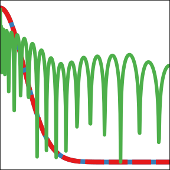
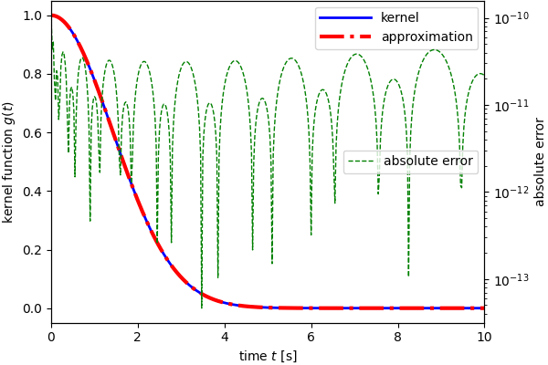
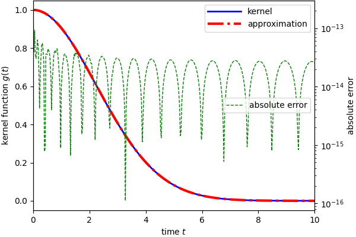
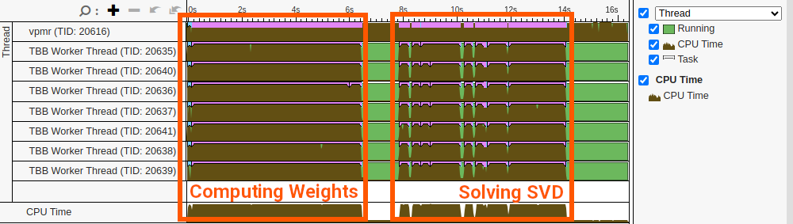

<div align="center">



# VPMR

**Approximate any smooth kernel as a sum of exponentials.**

*Parallel · arbitrary precision · C++17 core · Python bindings · CLI · Docker*

[](https://doi.org/10.5281/zenodo.7770193)
[](https://codecov.io/gh/TLCFEM/vpmr)
[](https://pypi.org/project/pyvpmr/)
[](https://hub.docker.com/r/tlcfem/vpmr/tags)
[](https://github.com/TLCFEM/vpmr/stargazers)
[](https://www.gnu.org/licenses/gpl-3.0.en.html)

[Overview](#overview) · [Install](#installation) · [Quick start](#quick-start) · [Python API](#python-api) · [CLI](#command-line-interface) · [Build](#building-from-source) · [Contributing](#contributing)

</div>

---

## Overview

VPMR finds a compact exponential sum that reproduces an arbitrary smooth kernel to a prescribed tolerance. In other words, it looks for a set of $m_j$ and $s_j$ such that

$$
\max_{t\in{}I}\left\|g(t)-\sum_jm_j\exp(-s_jt)\right\|<\epsilon,
$$

where $g(t)$ is the given kernel and $\epsilon$ is the target accuracy.

The result is a small, closed-form approximation — ideal for convolution, damping, and other integral kernels that would otherwise be expensive to evaluate.

> **Read more**
> - 📄 Reference paper: [10.1007/s10915-022-01999-1](https://doi.org/10.1007/s10915-022-01999-1)
> - 🧪 Original MATLAB implementation: [ZXGao97/VPMR](https://github.com/ZXGao97/VPMR)

## Highlights

| | Feature | What it gives you |
|---|---|---|
| ⚡ | **Parallel by design** | TBB-backed computation with parallel SVD, so larger `n` stays practical. |
| 🎯 | **Arbitrary precision** | GMP/MPFR arithmetic, with precision derived automatically from `n`. |
| 🧮 | **Kernel as an expression** | Write `exp(-t*t/10)` in a text file — no recompilation needed. |
| 🐍 | **Pythonic API** | `vpmr`, `evaluate`, `plot`, `split`, and suanPan damping helpers. |
| 📦 | **Zero-config distribution** | Prebuilt wheels, a standalone binary, and a Docker image. |
| 🖥️ | **Portable** | Linux, macOS, Windows via MSYS2/WSL. |

## Installation

### Dependencies

The following libraries are required at build and run time:

| Library | Purpose |
|---|---|
| [gmp](https://gmplib.org/) | Multiple precision arithmetic |
| [mpfr](https://www.mpfr.org/) | Multiple-precision floating-point computations |
| [tbb](https://github.com/oneapi-src/oneTBB) | Parallel computing |

The following libraries are bundled:

| Library | Purpose |
|---|---|
| [mpreal](http://www.holoborodko.com/pavel/mpfr/) | `mpreal` type C++ wrapper |
| [Eigen](https://eigen.tuxfamily.org/) | Matrix decomposition |
| [exprtk](https://github.com/ArashPartow/exprtk.git) | Expression parsing |
| [exprtk-custom-types](https://github.com/ArashPartow/exprtk-custom-types.git) | `mpreal` support for exprtk |

Install the toolchain and system libraries:

```bash
# RPM-based Linux (dnf)
sudo dnf install -y gcc-c++ tbb-devel mpfr-devel gmp-devel

# DEB-based Linux (apt)
sudo apt install -y g++ libtbb-dev libmpfr-dev libgmp-dev

# macOS (Homebrew)
brew install gcc tbb mpfr gmp
```

If you only run a prebuilt binary or wheel, you just need the runtimes. Look up the exact package names for `tbb`, `gmp`, and `mpfr` on [pkgs.org](https://pkgs.org/).

> [!WARNING]
> Windows users need a working [MSYS2](https://www.msys2.org/) environment — see [Building from source](#building-from-source). On other platforms, install `gmp` and `mpfr` using your own package manager.

### 🐳 Docker

Pull and run the image:

```bash
docker pull tlcfem/vpmr
# or from GitHub Container Registry
docker pull ghcr.io/tlcfem/vpmr

docker run tlcfem/vpmr -n 30
```

Build it locally with the provided `Dockerfile`:

```bash
wget -q https://raw.githubusercontent.com/TLCFEM/vpmr/master/resource/Dockerfile
docker build -t vpmr -f Dockerfile .
```

### 🐍 Python package

Wheels are available for Linux and macOS:

```bash
pip install pyvpmr
```

If no wheel matches your platform, the package is compiled from source, which takes a few minutes. Running the algorithm always requires `gmp`, `mpfr`, and `tbb`.

> [!WARNING]
> The Python module is a binding around the native core: the external libraries above must be installed even when a wheel is used.

## Quick start

```python
import numpy as np

from pyvpmr import evaluate, plot, vpmr


def kernel(x):
    return np.exp(-(x**2) / 4)


if __name__ == "__main__":
    result = vpmr(n=50, k="exp(-t*t/4)")

    # The result is a named tuple, so both styles are valid:
    #   m, s = result
    #   result.m, result.s
    approximation = evaluate(result.m, result.s, np.linspace(0, 10, 401))

    plot(result.m, result.s, kernel)
```

One call gives you the coefficients; `evaluate` and `plot` let you inspect the fit.

## Python API

`pyvpmr` exposes the algorithm through a small, typed API.

### `vpmr(...)`

```python
from pyvpmr import vpmr

result = vpmr(
    n=20,          # maximum number of terms
    c=4,           # maximum exponent
    d=0,           # precision bits, 0 selects the required precision
    q=500,         # Gauss-Legendre quadrature order
    m=1.05,        # precision multiplier
    e=1e-8,        # tolerance
    k="",          # kernel expression in t, empty uses exp(-t*t/4)
    omit=True,     # omit numerically trivial terms
    verbose=False, # print progress information
)
```

The return value is a `VPMRResult`, a named tuple of two complex NumPy arrays. Unpacking works as before:

```python
m, s = vpmr(n=50)
```

Both arrays satisfy

$$
g(t)\approx\sum_j m_j\exp(-s_jt).
$$

Arguments are validated: invalid input raises `TypeError` or `ValueError`, and an invalid kernel expression raises `RuntimeError`. Progress output is off by default; pass `verbose=True` to see the effective parameters and each step.

### `evaluate`

```python
import numpy as np

from pyvpmr import evaluate, vpmr

result = vpmr(n=50)
t = np.linspace(0, 10, 401)
y = evaluate(result.m, result.s, t)

# Compare with the reference kernel
error = np.abs(np.exp(-(t**2) / 4) - y)
```

`evaluate` accepts a scalar or an array and returns a complex scalar or array.

### `plot`

```python
from pyvpmr import plot, vpmr

result = vpmr(n=50)
fig, ax, error_ax = plot(
    result.m,
    result.s,
    lambda t: np.exp(-(t**2) / 4),
    xlim=(0, 10),
    show=False,
    save_to="approximation.png",
)
```

`plot` lazily imports Matplotlib and returns the figure and both axes, so the result can be customized further. Matplotlib is a regular dependency — no extra installation step.

### `split`

Convert the textual `M` and `S` blocks printed by the standalone binary into arrays:

```python
from pyvpmr import split

result = split(open("vpmr-output.txt").read())
```

### suanPan damping commands

`to_global_damping` and `to_elemental_damping` generate suanPan commands from the approximation. They accept `(m, s)`, `((m, s),)`, or a single `VPMRResult`:

```python
from pyvpmr import to_elemental_damping, to_global_damping, vpmr

result = vpmr(n=60)
print(to_global_damping(result))
print(to_elemental_damping(result.m, result.s))
```

### Running the tests

```bash
pip install pytest
python -m pytest
```

The API-level tests run without the compiled extension; tests that exercise the numerical core are skipped automatically when `_pyvpmr` is unavailable.

## Command-line interface

```text
Usage: vpmr [options]

Options:

    -n, --max-terms             <int>     number of terms (default: 20)
    -c, --max-exponent          <int>     maximum exponent (default: 4)
    -d, --precision-bits        <int>     number of precision bits (default: automatic)
    -q, --quadrature-order      <int>     quadrature order (default: 500)
    -m, --precision-multiplier  <float>   precision multiplier (default: 1.05)
    -e, --tolerance             <float>   tolerance (default: 1E-8)
    -k, --kernel                <string>  file name of kernel function (default uses: exp(-t*t/4))
        --no-omit                         do not omit trivial terms
    -s, --singular-values                 print singular values
    -w, --weights                         print weights
    -h, --help                            print this help message
```

### Choosing the precision

The minimum required precision is estimated from $n$: the algorithm computes $C(4n,k)$ and $2^{4n}$, so the number of precision bits should be at least

$$
4n+\log_2 C(4n,2n).
$$

In the implementation, this number is further multiplied by the precision multiplier `m`.

## Examples

### Default kernel

The default kernel is `exp(-t^2/4)`:

```bash
./vpmr -n 30
```

<details>
<summary><strong>Show sample output</strong></summary>

```text
Using the following parameters:
       terms = 30.
    exponent = 4.
   precision = 355.
 quad. order = 500.
  multiplier = 1.0500e+00.
   tolerance = 1.0000e-08.
      kernel = exp(-t*t/4).

[1/6] Computing weights... [60/60]
[2/6] Solving Lyapunov equation...
[3/6] Solving SVD...
[4/6] Transforming (P=+11)...
[5/6] Solving eigen decomposition...
[6/6] Done with 11 final terms.

M = 
+2.3132817597168739e+01-2.8586221856566439e-105j
-1.1577276470339980e+01+1.2090460362812458e+01j
-1.1577276470339980e+01-1.2090460362812458e+01j
-1.5850953326980194e-01+6.1693993683365882e+00j
-1.5850953326980194e-01-6.1693993683365882e+00j
+7.3529603986874903e-01+7.5750538019498470e-01j
+7.3529603986874903e-01-7.5750538019498470e-01j
-6.6807938653881516e-02+1.0261144687127986e-02j
-6.6807938653881516e-02-1.0261144687127986e-02j
+8.8910386408859823e-04+2.2917263647765330e-04j
+8.8910386408859823e-04-2.2917263647765330e-04j
S = 
+2.0729005744773779e+00-0.0000000000000000e+00j
+2.0678104641951456e+00+5.6013828454286663e-01j
+2.0678104641951456e+00-5.6013828454286663e-01j
+2.0525989324387557e+00-1.1331825475504296e+00j
+2.0525989324387557e+00+1.1331825475504296e+00j
+2.0268330855090184e+00+1.7349515936847757e+00j
+2.0268330855090184e+00-1.7349515936847757e+00j
+1.9884211467751960e+00-2.3916428978210722e+00j
+1.9884211467751960e+00+2.3916428978210722e+00j
+1.9308660033206897e+00-3.1676394473339076e+00j
+1.9308660033206897e+00+3.1676394473339076e+00j

Running time: 1987 ms.
```

</details>



### Arbitrary kernel

Provide the kernel in a text file as a function of `t`. Expressions are parsed with [exprtk](https://www.partow.net/programming/exprtk/) — see its documentation for the supported syntax.

For example, to approximate `exp(-t^2/10)`, create `kernel.txt`:

```text
exp(-t*t/10)
```

```bash
echo "exp(-t*t/10)" > kernel.txt
 ./vpmr -n 60 -k kernel.txt -e 1e-12
```



## Performance

Most of the algorithm is parallelized to extract maximum performance. Below is a typical profile on an i7-10750H with `./vpmr -n 80`:



## Building from source

> [!WARNING]
> The application relies on Eigen and exprtk, which use templates heavily. Compilation takes minutes and around 2 GB of memory. Install `gmp`, `mpfr`, and `tbb` first.

### Windows

Use [MSYS2](https://www.msys2.org/), or follow the Linux instructions below with WSL.

```bash
# install necessary packages
pacman -S git mingw-w64-x86_64-cmake mingw-w64-x86_64-tbb mingw-w64-x86_64-gcc mingw-w64-x86_64-ninja mingw-w64-x86_64-gmp mingw-w64-x86_64-mpfr
# clone the repository
git clone --recurse-submodules --depth 1 https://github.com/TLCFEM/vpmr.git
cd vpmr
# apply patch to enable parallel evaluation of some loops in SVD
cd eigen && git apply --ignore-space-change --ignore-whitespace ../parallelize.patch && cd ..
# configure and compile
cmake -G Ninja -DCMAKE_BUILD_TYPE=Release .
ninja
```

### Linux

The following is based on Fedora:

```bash
sudo dnf install gcc g++ cmake git tbb-devel mpfr-devel gmp-devel -y
git clone --recurse-submodules --depth 1 https://github.com/TLCFEM/vpmr.git
cd vpmr
cd eigen && git apply --ignore-space-change --ignore-whitespace ../parallelize.patch && cd ..
cmake -DCMAKE_BUILD_TYPE=Release .
make
```

## Contributing

Contributions are welcome! Help is especially wanted with:

- [ ] **More performant parallel SVD** — `eigen` only provides sequential SVD
- [ ] **Alternative integration** — currently only Gauss-Legendre quadrature is available

Open an [issue](https://github.com/TLCFEM/vpmr/issues) to discuss ideas, or submit a pull request.

## License & citation

Licensed under [GPL-3.0-or-later](https://www.gnu.org/licenses/gpl-3.0.en.html).

If VPMR is useful in your work, please cite the [reference paper](https://doi.org/10.1007/s10915-022-01999-1) and archive [10.5281/zenodo.7770193](https://doi.org/10.5281/zenodo.7770193).

<div align="center">

**[⬆ Back to top](#vpmr)**

</div>
